# Contribution Garden

This turns your GitHub contributions into a cozy little garden instead of the usual green squares. Every day of the last year is a tile on a floating garden island, and the more you code, the more stuff grows. It updates itself every day, so you don't have to do anything once it's set up.



## Quick start

**1.** In your profile repo (the one with the same name as your username), create a file called `.github/workflows/garden.yml` with this in it:

```yaml
name: Contribution garden

on:
  schedule:
    - cron: '17 3 * * *' # once a day
  workflow_dispatch:

permissions:
  contents: write

jobs:
  garden:
    runs-on: ubuntu-latest
    steps:
      - uses: actions/checkout@v5
      - uses: NightingaleX03/github-contribution@v1
```

**2.** Go to the **Actions** tab, click **Contribution garden** and press **Run workflow**. After about a minute, your garden is saved in a `garden` folder in your repo.

**3.** Add this to your profile `README.md` wherever you want the garden:

```html

```

That's it! If you had another contribution graphic set up before, delete its workflow file and the folder it made, so the two don't both run.

## Options

You can add any of these under the `uses:` line with `with:`:

```yaml
      - uses: NightingaleX03/github-contribution@v1
        with:
          look: sun
          latitude: 40.7
          longitude: -74.0
```

| Option | What it does | Default |
| --- | --- | --- |
| `look` | `sun`, `light` or `dark` (see below) | `light` |
| `latitude` | Roughly where you live, for the `sun` look | |
| `longitude` | Roughly where you live, for the `sun` look | |
| `config` | A JSON file in your repo with any other settings you want to change (see [Changing things](#changing-things)) | |
| `output-dir` | The folder the pictures are saved in | `garden` |
| `username` | Whose contributions to show | The repo owner |
| `github-token` | A personal access token, if you want private contributions counted | The normal GitHub token |
| `commit` | Set to `false` if you want to commit the pictures yourself | `true` |

### Pick how it looks

| Look | What it does |
| --- | --- |
| `light` | Always the sunny afternoon garden. |
| `dark` | Always the cozy evening garden, with lit lanterns and fireflies. |
| `sun` | Follows the sun where you live: the afternoon garden during the day and the evening garden after sunset. It uses real sunrise and sunset times for your location, so it changes with the seasons. |

For `sun`, just use a nearby city for `latitude` and `longitude`. You don't need your exact location (one decimal place is about 10 km, so nobody can find your house from it). You also need it to run every hour instead of once a day, so change the cron line to `'17 * * * *'`. It only commits when the picture actually changes.

**Bonus option:** if you'd rather it match whoever is looking at it (light if their GitHub is in light mode, dark if it's in dark mode), use this in your README instead:

```html
<picture>
  <source media="(prefers-color-scheme: dark)" srcset="garden/garden-dark.svg">
  <source media="(prefers-color-scheme: light)" srcset="garden/garden-light.svg">
  
</picture>
```

## How the tiles grow

Each tile is one day, and it grows based on how much you coded that day (the same levels GitHub uses for the green squares).

| That day | What grows |
| --- | --- |
| Nothing | Just grass, maybe a pebble or a little clover |
| A little | A tiny sprout |
| Some | A bush with a bud on it |
| A lot | A bush with flowers |
| A LOT | A full bloom in a wooden planter box |

The weeks go along the island from left to right. Sunday to Wednesday are behind the stone path, and Thursday to Saturday are in front of it.

## Goals

This is the fun part: the garden unlocks things based on how many contributions you have in the year.

| Contributions | What you get |
| --- | --- |
| 100 | A starter cottage and a little wooden fence |
| 250 | A cherry blossom tree and garden lanterns |
| 1,000 | A wooden bench (with a tiny teapot), and the cottage becomes a cozy cottage with a porch, climbing roses and smoke coming out of the chimney |
| 2,000 | The storybook cottage, with a whole second floor, a window on the roof and a round attic window |

Other things that show up:

- **Streaks:** if you code 7 or more days in a row, a little wooden arch with vines grows over the path at that week. The longest streak gets the biggest arch.
- **Stars:** every star on your repos is a butterfly (up to 12).
- **Forks:** every fork is a bee (up to 8).

## Flowers for each language

Every language is its own kind of flower, and the colors are softer versions of GitHub's language colors.

| Language | Flower |
| --- | --- |
| TypeScript | Hydrangea |
| JavaScript | Sunflower |
| Python | Iris |
| Rust | Rose |
| Go | Forget-me-not |
| HTML | Tulip |
| CSS | Cosmos |
| Java | Poppy |
| C | Daisy |
| C++ | Dahlia |
| C# | Camellia |
| Ruby | Peony |
| PHP | Lavender |
| Swift | Marigold |
| Kotlin | Anemone |
| Shell | Lily |
| Dart | Bluebell |

Any other language gets whichever flower isn't being used yet. Tiny languages (under 3%) are grouped together as "other" and show up as wildflowers.

The flower on each day comes from whichever language you committed to most that day. On the side, there's a bouquet in a teapot that matches your language percentages, so if you're 60% TypeScript, most of the bouquet is hydrangeas. There's a little legend next to it and a wooden sign with your stats.

## Changing things

Want different milestones, flowers or colors? Make a JSON file in your repo with just the things you want to change, for example `garden.json`:

```json
{
  "milestones": { "tree": 100, "bench": 500 },
  "species": { "Elixir": "lavender" },
  "languageColors": { "Python": "#6a8fd8" },
  "excludeLanguages": ["Jupyter Notebook", "HTML"]
}
```

Then point the action at it:

```yaml
      - uses: NightingaleX03/github-contribution@v1
        with:
          config: garden.json
```

Everything you can change is listed in [`garden.config.ts`](garden.config.ts), including all the colors for light and dark mode.

## Private contributions

By default, it only uses public data and the normal GitHub token, so there's nothing to set up. If you want private contributions counted:

1. Turn on "Include private contributions on my profile" in your GitHub profile settings.
2. Create a fine-grained personal access token that's read-only and has an expiration date.
3. Add it to your profile repo as a repository secret called `GARDEN_TOKEN`.
4. Pass it to the action:

```yaml
      - uses: NightingaleX03/github-contribution@v1
        with:
          github-token: ${{ secrets.GARDEN_TOKEN }}
```

If you also want private repo languages and stars counted, add `"includePrivate": true` to your config file. Heads up: this shows private activity counts and languages in the picture (but never repo names).

## Trying it on your computer

If you want to play with the code, clone this repo and run:

```bash
npm install
npm run preview:demo
```

That makes a garden with sample data and opens it in your browser. To see your real one:

```bash
GITHUB_TOKEN=your_token GARDEN_USERNAME=your_username npm run preview
```

On Windows PowerShell, use `$env:GITHUB_TOKEN="your_token"; $env:GARDEN_USERNAME="your_username"; npm run preview`.

## What's in here

| File | What it does |
| --- | --- |
| `action.yml` | Tells GitHub how to run the action |
| `garden.config.ts` | All the default settings |
| `src/settings.ts` | Combines the defaults, your config file and your options |
| `src/github.ts` | Gets the contribution data from GitHub |
| `src/model.ts` | Works out the flower for each day, the streaks and the bouquet |
| `src/flowers.ts` | Draws all the flowers |
| `src/render.ts` | Draws the whole garden |
| `src/index.ts` | Makes the SVG files |
| `src/sun.ts` | Works out whether the sun is up where you live |
| `src/preview.ts` | The local preview |
| `src/demo.ts` | Sample data for the preview |
| `.github/workflows/garden.yml` | Keeps the example garden above up to date |

## License

MIT, so feel free to use it for your own profile. See [`LICENSE`](LICENSE).
